<p align="center">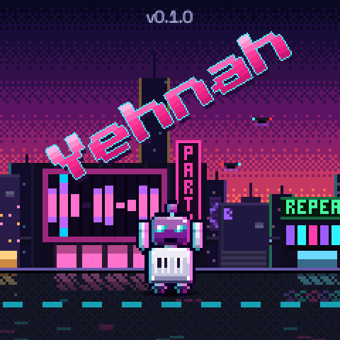</p>

<h1 align="center">Yehnah</h1>

<p align="center"><b>A six-track synth, drum machine and song sequencer for the M-VAVE FM-1</b><br>
25 synthesis engines, chords on one finger, ideas that write for you, and an editor and emulator that run in the browser</p>

<p align="center">
  <a href="LICENSE"></a>
  
  
</p>

<p align="center">
  <a href="https://mello-d.github.io/yehnah/webapp/installer/"><b>Install in the browser</b></a> ·
  <a href="https://mello-d.github.io/yehnah/emu/"><b>Try the emulator</b></a> ·
  <a href="https://mello-d.github.io/yehnah/webapp/editor/">Web editor</a> ·
  <a href="docs/MANUAL.md">Manual</a> ·
  <a href="https://github.com/Mello-D/yehnah/issues">Report a bug</a>
</p>

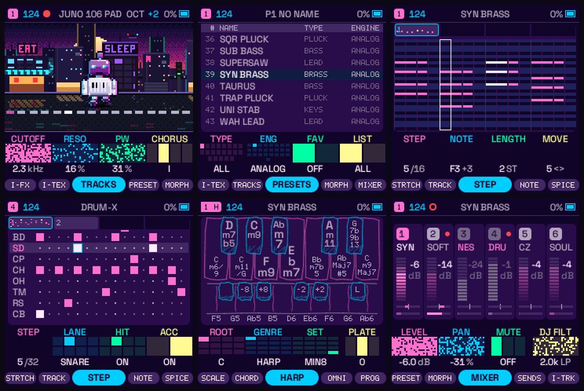

Yehnah turns the FM-1 into a six-track instrument: twenty-five synthesis engines with over 700 factory sounds, drum
machines that morph between two sides of a kit, a 64-step sequencer with chords and parameter locks, songs made of
sections and scenes, one-key chords played like an Omnichord or a guitar, a modulation matrix, punch-in effects, and
IDEAS, which write a pattern, a sound, an LFO, an effect or an ambient texture for the track you are on. Everything is
synthesised in real time: there are no samples. It comes with a web installer, a web editor and an emulator that runs
the firmware itself in the browser.

> **Status:** a development release (`v0.1.0`). It is custom firmware: install it at your own risk, and read
> [Install](#install) first. Your music is backed up before the installer writes anything, and the way back to the
> official firmware is one click.

Yehnah is free software. It is built on [JIANT FM](https://github.com/juanjiant-bit/JIANT) by Juan Jiant, which grew
from [Felucca](https://github.com/hugelton/Felucca) by Hügelton Instruments, and it brings in the work of several other
FM-1 projects: see [Credits](#credits). It is not Felucca or JIANT FM: please report Yehnah's behaviour
[here](https://github.com/Mello-D/yehnah/issues), not in their Issues.

## Contents

1. [Try it first](#try-it-first)
2. [Install](#install)
3. [A tour](#a-tour)
4. [Engines](#engines)
5. [The layers](#the-layers)
6. [MIDI and USB](#midi-and-usb)
7. [The web editor](#the-web-editor)
8. [Specifications](#specifications)
9. [Building and testing](#building-and-testing)
10. [Documents](#documents)
11. [Credits](#credits)
12. [Licence](#licence)

## Try it first

The **[emulator](https://mello-d.github.io/yehnah/emu/)** is the firmware itself, compiled to WebAssembly, drawn as an
FM-1 you play with the mouse, a touch screen or the computer keyboard. Nothing is installed and nothing leaves your
computer. It is the quickest way to learn the pages and to hear an engine before you put it on the unit.

## Install

This is custom firmware, at your own risk.

1. **Back up first.** The installer saves a complete backup of the unit before it writes.
2. **Coming from another custom firmware? Return to official V15 first**, then install Yehnah: writing it straight over
   another custom firmware has bricked an FM-1. The installer checks the unit first and writes only over official V15
   or over Yehnah.
3. **In the browser** (Chrome or Edge on a computer): open the
   **[Yehnah installer](https://mello-d.github.io/yehnah/webapp/installer/)**, connect the FM-1 by USB and follow it.
   The same page takes the unit back to official V15 (**Return to official V15**).
4. **Offline, with Python 3:** `python3 tools/fm1_install.py build/yehnah.fwsc` (see [BUILDING.md](BUILDING.md)).
5. If the FM-1 crashes, freezes or clicks, hold **REC** while switching it on (one core) and note what
   GLO > SYSTEM > ABOUT says.
6. **Back to the official firmware:** the installer's *Return to official V15*, or M-VAVE's own updater.

If the unit stays black after an interrupted update, check whether the computer sees it as **WL80UBOOT** (USB device
4C4A:8057): that is the chip's boot mode, and running the installer again with another cable recovers it. If that is not
enough, [FM-1 Transporter](https://github.com/kurogedelic/FM-1-transporter) reads and writes the flash with a Seeed XIAO
RP2040.

## A tour

### HOME: the track you are on

HOME shows the selected track as a small robot that dances to what the track plays, on a city street at dusk or by night.
Under it are the track's four knobs (the engine decides which four), and the pages of HOME are tabs along the foot:
**TRACKS**, **PRESETS**, **MORPH**, **MIXER**, **SENDS** and the five **IDEAS** pages. Turn ALGORITHM to move
between the tracks: **TRACKS 4** is the default, and **TRACKS 6** brings in the last two.

<table>
<tr>
<td align="center">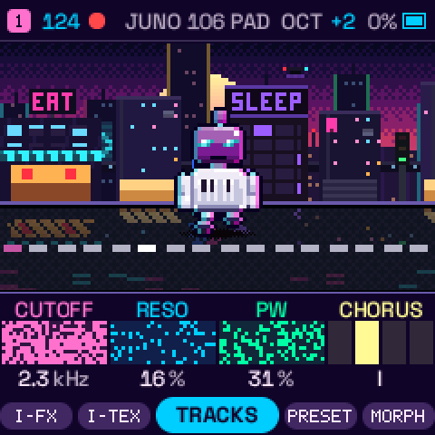<br><sub>HOME: the track's robot, its four knobs, the tabs</sub></td>
<td align="center">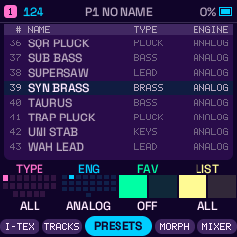<br><sub>PRESETS: one list over every engine, by name, type and engine</sub></td>
</tr>
</table>

- **One sound list.** Over 700 factory sounds, browsed with PRESETS: each has a type (bass, lead, pad…) and an engine.
  Favourites and 32 user presets sit in the same list. **MORPH** blends two tracks into one part. Switching a track to
  another engine fades the old one out, and the notes you hold go on in the new one.
- **IDEAS.** The five IDEAS tabs throw ideas for the selected track, each heard at once: **TRACK** writes a pattern (a
  genre's progression, voicing and figures, a rhythm cell, a role: bass, chords, melody or arp), **SOUND** picks a preset
  or varies the sound (PRESET, VARY, WILD, and ENGINE: the same engine or any), **LFO** and **FX** throw an LFO or an
  effect (drive, space, movement), and **TEXTURE** makes what the track plays ambient: a pad, choir, hiss, sea or crackle
  sound, softer and longer notes, a wider space. OCT+ keeps an idea, OCT− puts back what was there before; and UNDO
  (REC held + D4) brings back the one before.

### Sequencer

<table>
<tr>
<td align="center">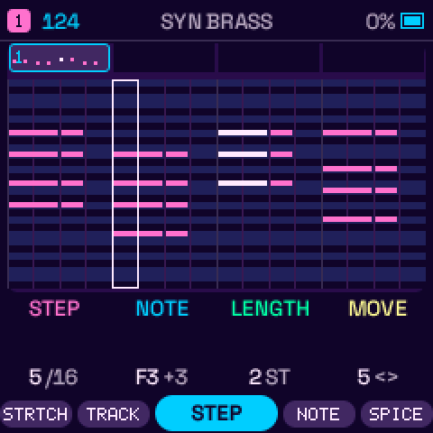<br><sub>STEP: a piano roll of the pattern, chords and lengths</sub></td>
<td align="center">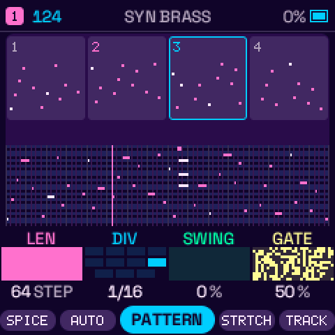<br><sub>PATTERN: the bars, LEN, DIV, SWING, GATE</sub></td>
<td align="center">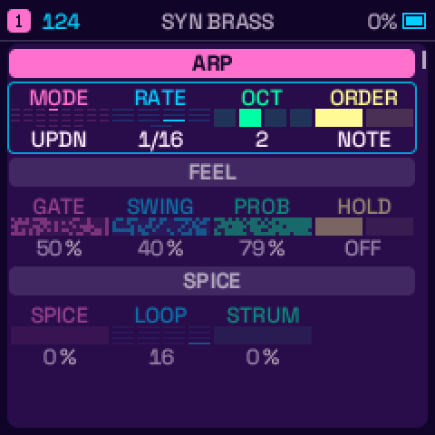<br><sub>ARP: modes, rate, octaves, feel</sub></td>
</tr>
</table>

- **64 steps per track**, each track with its own length, division, swing and gate, so patterns of different lengths
  drift in and out of phase. Notes can be longer than a step (ties), chords keep all their notes, and a note can be
  lengthened or shortened afterwards without recording again.
- **Parameter locks.** Hold a step and turn a knob: that step plays its own value of any parameter.
- **Per-step control:** ratchets, a step's **probability**, **fill-only** steps and **micro timing**.
- **Live recording** with quantise off or on (the timing you played is kept as a nudge), a count-in and an optional click.
- **An arpeggiator with 27 modes**, a hold, a swing and a probability, and **a separate strum player** for the GUITAR
  chords with its own pattern, division and sweep.
- **A motion lane.** Knob moves and incoming MIDI CCs are recorded as automation and played back with the steps.

### Chords, played with one finger

<table>
<tr>
<td align="center">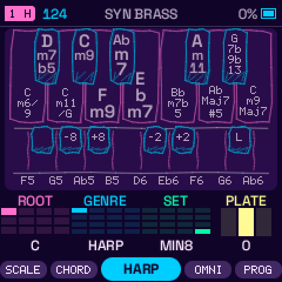<br><sub>HARP: a strip of chord keys, a genre and a set</sub></td>
<td align="center">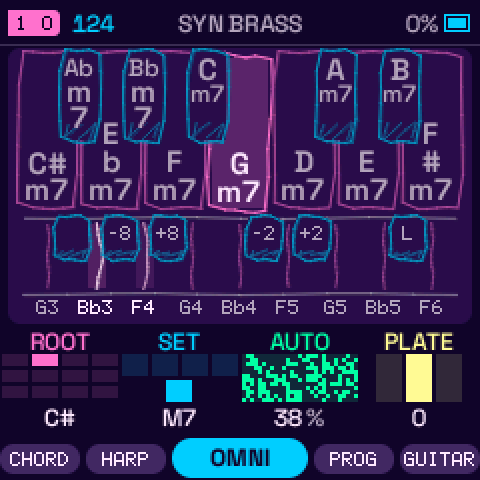<br><sub>OMNI: the Omnichord's chord keys and strum plate</sub></td>
<td align="center">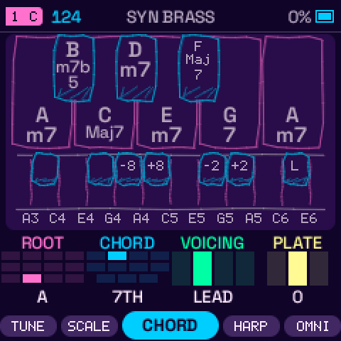<br><sub>CHORD: one key, one chord, in key</sub></td>
</tr>
</table>

- **SCL > CHORD.** TRIAD, 7TH, ADD9, SUS2 and SUS4 are always in key; MAJ, MIN, 7, MAJ7, MIN7 and POWER work on any
  key. VOICING: CLOSE, LEAD (voice leading), OPEN or +BASS. Chords record into steps, arpeggiate and light up the keys
  so you can learn them.
- **Handheld-style playing** after the Omnichord and the Orchid: STRUM spreads the notes low to high like a harp, and
  the **HARP** and **OMNI** tabs draw the chord keys as a strip you play with one finger. **PROG** holds chord
  progressions and can write them onto a track, and **GUITAR** plays 50 chord styles in 14 tunings.
- **16 scales** with a root that is global for the song, a QUANT mode (off, snap, white keys walk the scale, or the
  sequencer snaps too) and **a key stored with each section**, so a song can change key from one section to the next.

### Drums

<table>
<tr>
<td align="center">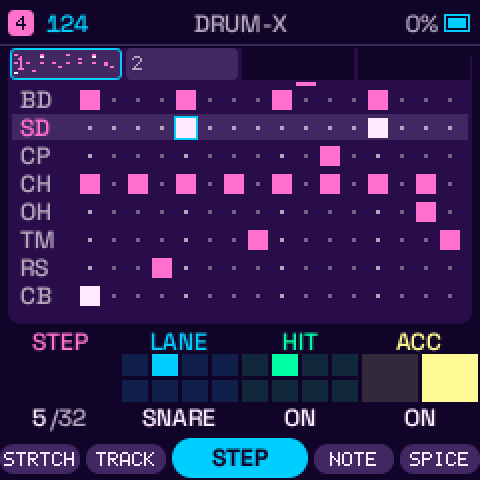<br><sub>The drum grid: eight lanes, hits, lane levels</sub></td>
<td align="center">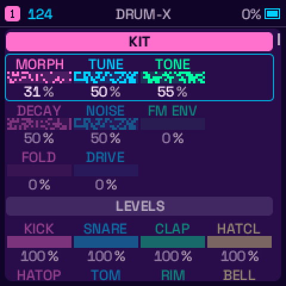<br><sub>DRUM-X: MORPH moves the whole kit between its two sides</sub></td>
</tr>
</table>

- **DRUM-X** is a synthesised kit of eight sounds (BD SD CP CH OH TM RS CB) generated in real time. Every sound has two
  sides, **A** and **B**, and **MORPH** moves the whole kit between them: the knob to play live. There are twenty kit
  presets, among them 808 BOOM, LOFI DUST, INDUSTRIAL, ACOUSTIC, DUB ROOTS, TECHNO RAW, ROCK KIT, JAZZ KIT, 808 CIRCUIT,
  909 SWEEP, ARCADE CHIP, RHYTHM BOX and PUNCH KIT.
- **HORT** is a second drum machine built from [Hortator](https://github.com/deadactive/hortator)'s drum models, with
  seven kit presets (808 MODEL, 909 MODEL, DIGITAL KIT, FM KIT, PUNCH KIT, BIG BOOM and BASIC KIT); **LCD-4** is a third.
  Every sound has its own tune and decay, layers and sends.
- **Hit modes on the keys:** the octave below plays SHORT, GHOST and FLAM, the octave above ratchets ×2, ×4 and ×8, in
  time with the step grid. In the EDIT layer the black keys mute the drum sounds.

### Songs, sections and scenes

<table>
<tr>
<td align="center">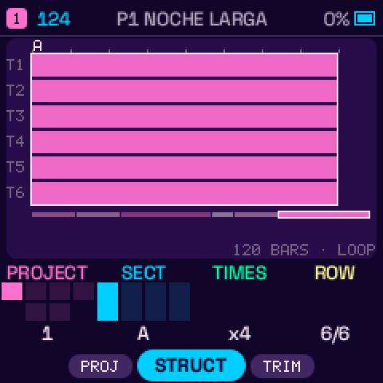<br><sub>ARRANGE: rows of sections, bars and scenes</sub></td>
<td align="center">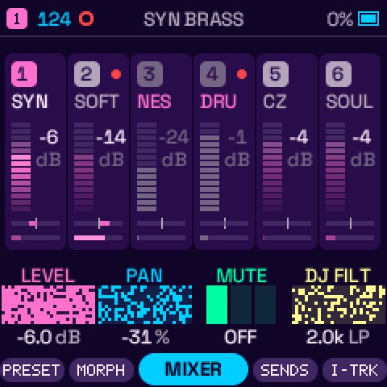<br><sub>MIXER: six strips, level, pan, mute, DJ filter</sub></td>
</tr>
</table>

- **6 projects, each of 4 sections (A–D)**: a section is a full snapshot of the music, every track's sound, steps and
  automation, the drum kit and its mutes, the punch-in lane, the slicer, the macros, the tempo and the global effects.
- **An arrangement of up to 16 rows**, each a section for 1–64 bars with an optional **scene** (the mutes, the drum group
  mutes, the macros and the punch-in effects held) and an END rule.
- **Play the sections live** from the REC layer: tap A–D to switch on the next bar, tap several in one hold for a **quick
  chain**, and **record the song** as you play it (the section system after [SLOOP](https://github.com/isod89/sloop-fm1)).
- **Autosave.** Set GLO > SYSTEM > RESTORE LAST to ON (it is off by default) and the music is kept as you stop and put back
  at power-on.

### Effects and master

<table>
<tr>
<td align="center">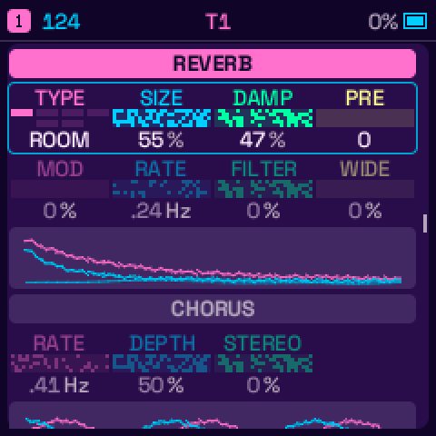<br><sub>FX ALL: every effect's rows on one scrollable page</sub></td>
<td align="center">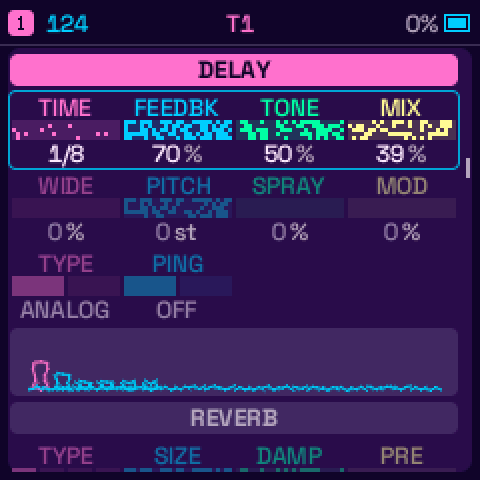<br><sub>DELAY: its taps, with the reverb below it</sub></td>
<td align="center">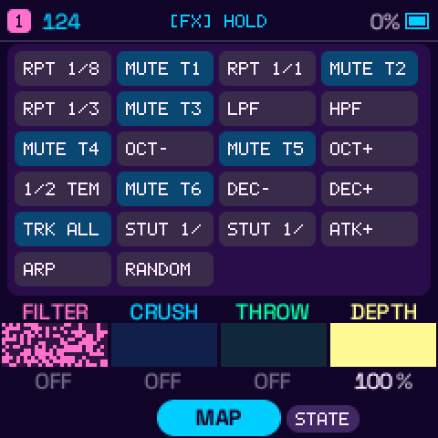<br><sub>The FX layer: punch-in effects, held on the keys</sub></td>
</tr>
</table>

- **Per track:** a drive (SOFT, HARD, FOLD, CRUSH, RECT, FUZZ, or a two-stage valve **AMP**) with a tone control, an
  auto-pan, a phaser, and sends to the buses.
- **Buses:** a delay (analog or digital, with ping-pong), **six reverb models** (ROOM, SPRING, SHIMR, RESO, CLOUD, REVRS),
  a chorus and a **slicer** with pitch steps that follow the scale.
- **Master:** a clipper, a drum bus and a ducker, and a DJ filter on the mixer.
- **Punch-in effects** while you hold FX: repeats, high and low-pass sweeps, an octave down or up, half tempo, stutters,
  short or long decays, slow attacks, a fill, random notes. The note effects are **recorded into a lane** that plays back
  with the section.

### Modulation

- **A modulation matrix** per track. Sources: LFO, ENV, VEL, KEY, RAND, mod wheel, aftertouch, expression, the four
  macros, **STEP** (the MSEQ step modulator) and a smooth NOISE wander. They reach the filter, pitch, shape and amplitude.
- **Envelopes and LFOs** per track on their own pages; ALL ENV shows the six tracks' envelopes side by side.

### A screen made of rows

<table>
<tr>
<td align="center">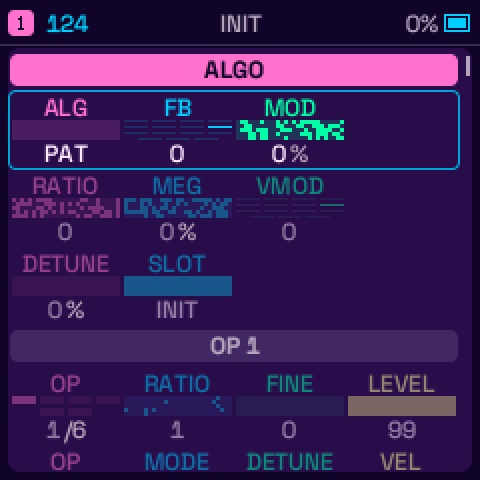<br><sub>FM6</sub></td>
<td align="center">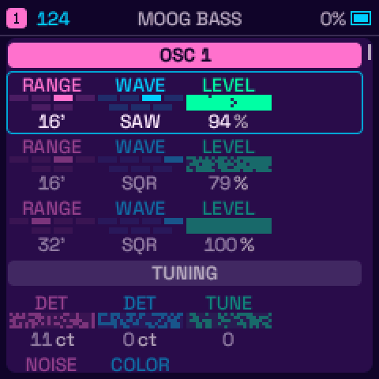<br><sub>FMINI</sub></td>
<td align="center">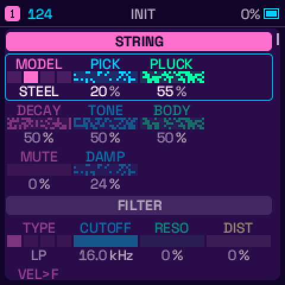<br><sub>GUITAR</sub></td>
<td align="center">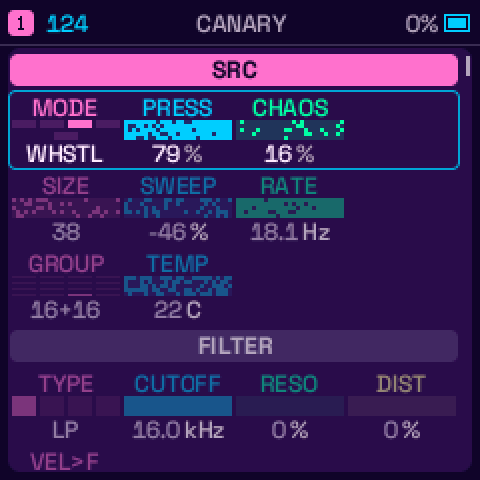<br><sub>ANIMAL</sub></td>
<td align="center">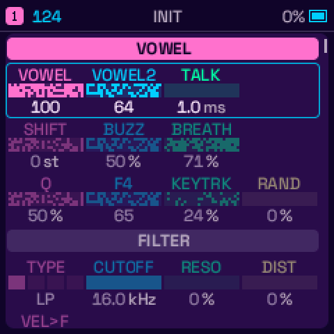<br><sub>VOICE</sub></td>
</tr>
</table>

SOUND is a scrollable list of rows: KNOB 1 scrolls, the other knobs set the row's values, and each value is a cell of four
with a picture for every pick. The same design carries the effects, the envelopes, the LFOs, the arpeggiator and the
GLO settings. Five colour themes change the look:

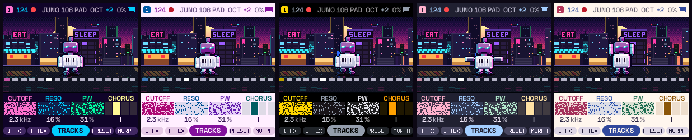

## Engines

Any engine can go on any track. **25 engines**, all synthesis:

| Engine | What it is |
| --- | --- |
| **ANALOG** | two oscillators (SAW, SQR, TRI, SIN, PWM, SYNC, RING, SAW3) into a per-voice filter |
| **DIGITAL** | a four-operator FM voice |
| **FM6** | six-operator FM from Dexed's core: 32 algorithms and a patch of its own on every track |
| **FMINI** | a Minimoog: a 24 dB ladder filter, oscillators, mixer and 200 factory patches |
| **PHASE** | phase distortion, after the CZ synths |
| **JUNO** | a Juno-106-style voice with its factory bank |
| **ACID** | a TB-303-style mono bass line |
| **VPS** | variable phase shaping |
| **WSEQ** | a sequence of up to 16 steps, each with its own wave, pitch and level |
| **TERRAIN** | eight wavetable surfaces you scan over |
| **VECTOR** | vector synthesis, after the Prophet VS and the Wavestation |
| **HYBRID** | three oscillators, two filters, two envelopes and two LFOs a voice, with its own patches |
| **LOFI** | chip and bytebeat sounds |
| **WHEEL** | a tonewheel organ with drawbars and a rotary speaker |
| **STRINGS** | a 1970s string machine (Solina, ARP, Elka) with divide-down registers |
| **GUITAR** | a plucked string (Karplus-Strong) with several guitar and bass models |
| **KALIMBA** | a kalimba by modal synthesis |
| **MODAL** | struck tines and bars, electric-piano tines and mallets |
| **PLAITS** | four of Mutable Instruments Plaits' models in fixed point |
| **DRIFT** | an ambient voice: six sine partials, each wandering on its own |
| **NOISE** | noise from white to coloured, through a resonant filter |
| **OMNI** | the Omnichord's voices |
| **VOICE** | sung vowels and typed words: formant synthesis after Klatt |
| **ANIMAL** | bird, mammal and insect calls from four physical primitives |
| **DRUM** | the DRUM-X, HORT and LCD-4 drum machines |

The [manual](docs/MANUAL.md#5-engines-and-the-sound-page) lists the engines' pages and knobs.

## The layers

Hold a button and the keys and the four knobs change job, while the screen draws a map of what they do. Tap the button
and its pages open. Four buttons have a layer:

<table>
<tr>
<td align="center"><br><sub><b>FX</b>: punch-in effects</sub></td>
<td align="center">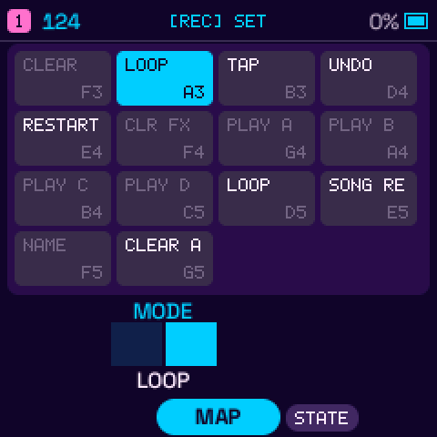<br><sub><b>REC</b>: undo, restart, sections, song</sub></td>
<td align="center">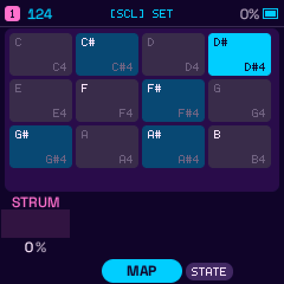<br><sub><b>SCL</b>: the root, and STRUM</sub></td>
<td align="center">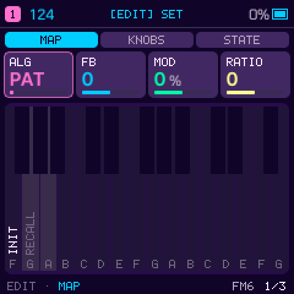<br><sub><b>EDIT</b>: INIT, RECALL, drum mutes</sub></td>
</tr>
</table>

- **FX:** the punch-in effects on the white keys, the track mutes while held, and FILTER, CRUSH, THROW and DEPTH on the
  knobs. Hold FX until its map opens and let go without touching anything: the layer stays open, with both hands free.
- **REC:** CLEAR the track, the record MODE, TAP tempo, **UNDO** and redo, RESTART from the top, CLR FX, play sections A–D
  on the next bar (several in one hold: a quick chain), LOOP / SONG, **SONG REC**, NAME and CLEAR ALL.
- **SCL:** the twelve keys set the root, and KNOB 1 is STRUM for every chord mode.
- **EDIT:** INIT puts the track's sound back to its engine's first preset (a drum track's kit to the factory one), RECALL
  puts it back as the playing section stored it, and on a drum track the black keys mute the drum sounds.

## MIDI and USB

- **USB MIDI**, class-compliant, in and out; **TRS MIDI IN** on the 3.5 mm jack. ROUTE sets which track each channel
  plays: CH1–6 for tracks 1–6, or every channel to the selected track.
- **MIDI out:** the keys, the clock, or everything the tracks play, each on its own channel.
- **Clock:** follow USB or TRS clock with start, continue and stop, or send it (24 pulses per beat).
- **Controllers:** CC 5, 7, 10, 71–75 and 91–94 (glide, level, pan, resonance, envelope, sends), CC 74 the engine's cutoff,
  **CC 16–23** the engine's own eight values, CC 102–105 the post filter, drive and sustain. Pitch bend, sustain,
  All Sound Off and All Notes Off work, and a CC you move is recorded as automation.
- **Program Change** loads sounds from the PRESETS list; channel 16 is the song's, and picks sections.
- **USB audio:** the master output as a stereo input on the computer, **STEMS** (eight channels: the six tracks, and the
  effects return in stereo), **IN+OUT**, which makes the FM-1 an audio output of the computer or phone as well, and a
  **TABLET** mode.

Not possible: MIDI out on the TRS jack (the jack is an input only) and Bluetooth MIDI. Details in the manual's
[MIDI and USB chapter](docs/MANUAL.md#14-midi-and-usb).

## The web editor

The **[editor](https://mello-d.github.io/yehnah/webapp/editor/)** talks to the unit over USB (SysEx, Chrome or Edge):
sounds, sequences, backups and the FM6 operators from a computer. A VOICE track shows a lyric box, and the **backup and
restore** keeps the whole unit. The protocol is in [web/EDITOR_PROTOCOL.md](web/EDITOR_PROTOCOL.md).

## Specifications

| | |
| --- | --- |
| Tracks | 6 (4 by default), sharing a budget of 8 voices (up to 12 on the FULL load setting) |
| Sounds | 25 engines, over 700 factory presets, 32 user presets, favourites |
| Drums | DRUM-X, HORT and LCD-4 machines, 8 sounds, A and B sides, 20 kit presets |
| Sequencer | 64 steps per track, own length, division, swing and gate, parameter locks, ratchets, probability, micro timing |
| Songs | 6 projects × 4 sections, an arrangement of 16 rows, scenes, SONG REC |
| Effects | drive, auto-pan, phaser, delay, 6 reverbs, chorus, slicer, master, DJ filter, punch-in effects with a recorded lane |
| MIDI | USB in and out, TRS in, clock in and out, CCs, Program Change |
| USB | MIDI, stereo audio, 8-channel stems, audio in |
| Update | from the browser with a backup first, or offline with Python |

## Building and testing

See [BUILDING.md](BUILDING.md). In short:

```
./build.sh                                              # firmware: build/yehnah.fwsc, and the installer site in build/site
web/emu/build.sh                                        # browser emulator: build/emu
tests/run_tests.sh                                      # host, web editor and emulator tests
python3 tools/gen_readme_images.py                      # the pictures in docs/img, from tests/ui_render.c's renders
```

The installer and the emulator are built and published to GitHub Pages by `.github/workflows/emulator.yml` on every push
to `main`. The public installer offers the commit named in `web/STABLE`, so a new version is tried in the emulator and
the preview installer before it reaches `webapp/installer/`.

## Documents

| Document | What's in it |
| --- | --- |
| [docs/MANUAL.md](docs/MANUAL.md) | The manual |
| [BUILDING.md](BUILDING.md) | Toolchain, build, emulator and tests |
| [CONTRIBUTING.md](CONTRIBUTING.md) | How to help |
| [web/EDITOR_PROTOCOL.md](web/EDITOR_PROTOCOL.md) | The editor's SysEx protocol |
| [LICENSING.md](LICENSING.md) | Licences of each part |
| [docs/plans/](docs/plans) | Design notes: navigation, levels, the sound page |

## Credits

Yehnah is made by Mello-D, and stands on a lot of other people's work. Thank you to all of them.

- **[JIANT FM](https://github.com/juanjiant-bit/JIANT)** by Juan Jiant (Argentina): the firmware Yehnah is built on.
- **[Felucca](https://github.com/hugelton/Felucca)** by [Hügelton Instruments](https://hugelton.com) (Leo Kuroshita,
  [@kurogedelic](https://github.com/kurogedelic)): JIANT's base; PHASE's waveforms (a port of
  [CrispyZebra](https://github.com/hugelton/CrispyZebra), GPL-3.0); the DRUM voices and kits; the
  [Fukiai](https://github.com/hugelton/Fukiai) icon font ([MIT](LICENSES/MIT-Fukiai.txt)). And Felucca's
  contributors: keremimo, ChanceTheMaker, andreahaku, spinkham, zednaked, jasonpersinger.
- **[Clipper](https://github.com/isod89/clipper-fm1)** by isod89 (GPL-3.0): the ANALOG, DIGITAL, PHASE, LOFI, NOISE, JUNO,
  ACID, VPS, WSEQ, TERRAIN, VECTOR, STRINGS, WHEEL and HYBRID engines and their sound banks.
- **[SLOOP](https://github.com/isod89/sloop-fm1)** by isod89 (GPL-3.0): the sections, quick chain and SONG REC system the
  song mode is based on.
- **[Hortator](https://github.com/deadactive/hortator)** by DEADACTIVE (GPL-3.0, itself built on Felucca): the drum models
  of the HORT kits (`firmware/src/hm_*.c`, `drum_hort.c`). Its ports of Plaits, stmlib and DaisySP keep their MIT license.
- **[FoMni](https://github.com/charlesvestal/fm1-fomni)** by Charles Vestal (GPL-3.0): the OMNI engine's voices and the
  OMNI chord layout, with its waves and shimmer after Chordian by Jan125 (CC0).
- **[FiMba-1](https://github.com/jadamsowers/fm1-fimba)** by jadamsowers (GPL-3.0): the KALIMBA tine, which MODAL's
  resonators build on.
- **[Optimist](https://github.com/w0ts/optimist)** by w0ts: PLAITS, a fixed-point port of Mutable Instruments Plaits
  (Emilie Gillet, MIT).
- **[hera-fm1](https://github.com/benbadio/hera-fm1)** by benbadio (GPL-3.0): the J-6 chord sets of HARP.
- **[FMini-1](https://github.com/ruppert/fmini-1)** by Guilherme Ruppert (GPL-3.0): FMINI, the Minimoog engine: its ladder
  filter, oscillators, mixer and its 200 factory patches (`firmware/src/eng_fmini.c`, `eng_fmini_data.h`,
  `eng_fmini_filter.h`; `tools/gen_fmini_data.py` makes the data files).
- **[guitchordi](https://github.com/stoogs/guitchordi)** by stoogs (GPL-3.0): SCL > GUITAR's 50 chord styles
  (`tools/gtr/`, `firmware/src/harp_gtr.h`).
- **[klattsch](https://github.com/tgies/klattsch)** by Tony Gies (MIT): VOICE is after it, with formant data from Klatt
  (1980) and Hillenbrand et al. (1995).
- **FM6:** msfa from [Dexed](https://github.com/asb2m10/dexed), Google Inc. and Pascal Gauthier
  ([Apache-2.0](LICENSES/Apache-2.0-msfa.txt)).
- **Both cores:** the way to start the AC79's second core and the guard against its misreads, after
  [Melodee](https://github.com/keremimo/melodee) by keremimo and [fm1-x0x](https://github.com/charlesvestal/fm1-x0x)
  by Charles Vestal (both GPL-3.0).
- **Emulator:** after [X0X](https://github.com/charlesvestal/fm1-x0x) by charlesvestal (GPL-3.0).
- **Testing and CPU work on a real FM-1:** **praztalfractal** ([GitHub: gospodindilly-ops](https://github.com/gospodindilly-ops)).
- **Fonts:** [Chakra Petch](https://github.com/m4rc1e/Chakra-Petch) ([SIL OFL 1.1](LICENSES/OFL-ChakraPetch.txt)),
  [IBM Plex Mono](https://github.com/IBM/plex) ([SIL OFL 1.1](LICENSES/OFL-IBMPlexMono.txt)),
  [Michroma](https://github.com/googlefonts/Michroma-font) ([SIL OFL 1.1](LICENSES/OFL-Michroma.txt)),
  [Inter Tight](https://github.com/rsms/inter-tight) ([SIL OFL 1.1](LICENSES/OFL-InterTight.txt)); in the emulator,
  [DotGothic16](https://github.com/fontworks-fonts/DotGothic16) ([SIL OFL 1.1](LICENSES/OFL-DotGothic16.txt)).
- **Package format:** [JieLi AC79 SDK](https://gitee.com/Jieli-Tech/fw-AC79_AIoT_SDK)
  ([Apache-2.0](LICENSES/Apache-2.0.txt); three of its files go into every package, none in this tree).

### AI-assisted development

Yehnah is developed with the help of AI agents for the code, the tests and the documentation. The instrument's design and
the decisions are made by its author.

## Licence

Free software: [GPL-3.0-only](LICENSE), like JIANT FM and Felucca. The fonts and the ported DSP keep their own
licenses ([LICENSES/](LICENSES/)); details in [LICENSING.md](LICENSING.md).

"Felucca" and "Hügelton Instruments" are names of Hügelton Instruments; Yehnah is not affiliated with them, nor with
JIANT FM's author. M-VAVE and FM-1 are trademarks of their owners; Yehnah is not affiliated with or endorsed by them.

Copyright (C) 2026 Leo Kuroshita (@kurogedelic), Hügelton Instruments — Felucca.
JIANT FM's and Yehnah's modifications are distributed under the same license.
